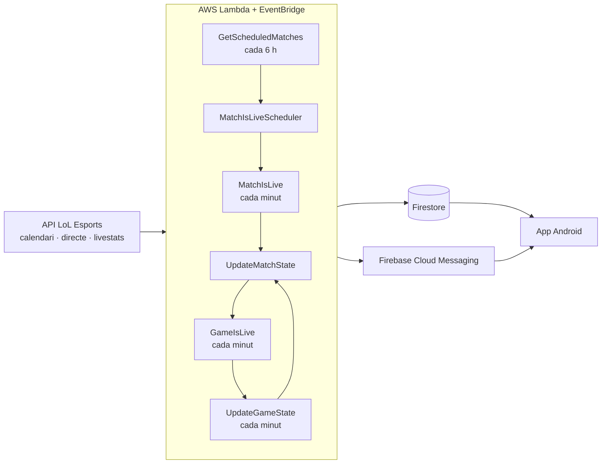

# League of Text

Aplicació Android per seguir en temps real els partits de les grans lligues de *League of Legends* (LCK, LEC, LCS, Mundial, MSI i First Stand). Mostra els partits programats, en directe i acabats, i envia una notificació push de cada esdeveniment dels partits que segueixes: primera sang, multikills, torres, dracs, barons, inhibidors, pauses i resultat.

La interfície s'inspira en l'app **Riot Mobile**: fons fosc, títols grans, fila de lligues, pestanyes amb subratllat daurat, targetes de partit amb el marcador amagat (ull) i, al detall, el selector de partides 1-5.

> Versió neta del Treball de Fi de Grau (Facultat de Matemàtiques i Informàtica, Universitat de Barcelona, 2022-2023), amb errors corregits, optimitzacions i sense cap credencial al codi. Els canvis respecte de la versió original estan detallats a [`docs/CANVIS.md`](docs/CANVIS.md).

## Arquitectura



| Lambda | Què fa |
|---|---|
| `GetScheduledMatches` | Recorre el calendari, desa els partits de les dues setmanes vinents (`state = scheduled`) i programa una regla *one-shot* una hora abans de cadascun. Si un partit canvia d'hora o d'equips, l'actualitza i el reprograma. |
| `MatchIsLiveScheduler` | Esborra la regla *one-shot* i afegeix el partit a la regla `MatchIsLive`. |
| `MatchIsLive` | Comprova cada minut si el partit ha començat; quan comença, el passa a `live` i invoca `UpdateMatchState`. Si al cap de 6 h no ha començat, deixa de vigilar-lo. |
| `UpdateMatchState` | Compta les victòries, envia el marcador i programa la partida següent, o tanca el partit (`completed`). |
| `GameIsLive` | Espera que hi hagi `livestats` de la partida i la crea. |
| `UpdateGameState` | Llegeix les instantànies (10 s cadascuna), genera els esdeveniments, els desa i els envia. |

## Estructura del repositori

```
android/                 App Android (Kotlin, Jetpack Compose, Material 3)
  app/src/main/java/com/leagueoftext/app/
    data/                Models, lectura de Firestore, repositoris (partits, subscripcions, sessió, preferències)
    notifications/       Recepció de FCM i notificacions agrupades per partit
    ui/                  Pantalles: Esports, detall del partit, Seguint, Perfil; tema i components
backend/                 Backend en Python per a AWS Lambda
  src/leagueoftext/      Codi compartit (API, lògica de partit i de joc, Firestore, FCM, EventBridge)
    handlers/            Un mòdul per Lambda
  tests/                 Tests amb pytest (lògica i flux complet amb dobles en memòria)
  template.yaml          Plantilla d'AWS SAM (6 Lambdes, capa de dependències i rol IAM)
  scripts/               Migració de les dades del model antic
firebase/                Regles de seguretat i índexs de Firestore
docs/                    Documentació addicional
```

## Model de dades (Firestore)

| Ruta | Contingut |
|---|---|
| `Matches/{matchId}` | `state` (`scheduled` · `live` · `completed`), `startTime`, `bestOf`, `league`, `blockName`, `teams`, `score`, `winnerId` |
| `Matches/{matchId}/Games/{gameId}` | `number`, `state`, `winnerId`, equips, temps de joc i estadístiques en directe (`stats.blue`, `stats.red`) |
| `…/Games/{gameId}/Notifications/{seq}` | `type`, `text`, `playingTime`, `side` i estadístiques en aquell moment |
| `Users/{uid}` | `subscribedMatches` (només el pot llegir i escriure el mateix usuari) |

Si tens dades del model antic (`ScheduledMatches`, `LiveMatches`, `CompletedMatches`), copia-les amb `backend/scripts/migrate_legacy_collections.py`. L'app també sap llegir les notificacions antigues.

## Credencials

**Cap credencial no és al repositori** (el `.gitignore` les exclou). Cal proporcionar-les així:

| Credencial | On va | Com s'obté |
|---|---|---|
| `google-services.json` | `android/app/` | Consola de Firebase → Configuració del projecte → App Android. Per iniciar sessió amb Google ha d'incloure un client OAuth de tipus web (s'hi afegeix sol en activar el proveïdor Google a Authentication). |
| Clau del compte de servei de Firebase | AWS Secrets Manager (`FirebaseCredentialsSecretArn`) o, en local, `GOOGLE_APPLICATION_CREDENTIALS` | Consola de Firebase → Comptes de servei → Genera una clau privada |
| Clau de l'API de LoL Esports | Paràmetre `LolEsportsApiKey` (variable `LOLESPORTS_API_KEY`) | Valor de la capçalera `x-api-key` de `esports-api.lolesports.com` |

## Posada en marxa

### App Android

1. Obre la carpeta `android/` amb una versió recent d'Android Studio que admeti AGP 9.5 (JDK 17 o posterior).
2. Copia el teu `google-services.json` a `android/app/`.
3. A Firebase, afegeix l'empremta SHA-1 del teu certificat de debug (`./gradlew signingReport`) i activa Google a Authentication.
4. Executa la configuració `app`.

Sense `google-services.json` l'app compila igualment i mostra una pantalla que explica què falta.

L'`applicationId` continua sent `com.example.tfg_salva` perquè el `google-services.json` del projecte original segueixi funcionant. Si registres una app nova a Firebase, canvia'l a `android/app/build.gradle.kts`.

### Firestore

```bash
cd firebase
firebase deploy --only firestore:rules,firestore:indexes
```

### Backend

Tests:

```bash
cd backend
python -m venv .venv && source .venv/bin/activate
pip install -r requirements-dev.txt
pytest
```

Desplegament amb AWS SAM:

```bash
cd backend
aws secretsmanager create-secret --name league-of-text/firebase --secret-string file://clau-firebase.json
sam build
sam deploy --guided   # demana LolEsportsApiKey i FirebaseCredentialsSecretArn
```

La plantilla crea les sis Lambdes (Python 3.12, arm64), la capa amb `firebase-admin` i `requests`, el rol IAM i l'execució periòdica de `GetScheduledMatches`. Les altres regles d'EventBridge les creen i les desactiven les mateixes Lambdes, de manera que només s'executen mentre hi ha partits actius.

Variables opcionals: `LEAGUES` (lligues separades per comes), `SCHEDULE_HORIZON_DAYS` (14), `WATCH_BEFORE_MINUTES` (60).

## Tecnologies

- **App:** Kotlin 2.4.21, Jetpack Compose (BOM 2026.09.00, Compose 1.12, Material 3), Navigation Compose, ViewModel + StateFlow, Coil, Firebase Auth (Google amb Credential Manager), Firestore (memòria cau persistent) i Cloud Messaging. Interfície 100% Compose, sense layouts XML. `minSdk` 24, `compileSdk`/`targetSdk` 37. Idiomes: català, castellà i anglès.
- **Compilació:** Gradle 9.6, Android Gradle Plugin 9.5 amb Kotlin integrat (sense el plugin `kotlin-android`), catàleg de versions a `android/gradle/libs.versions.toml`.
- **Backend:** Python 3.12, `requests`, `firebase-admin`, `boto3`, AWS Lambda, Amazon EventBridge, AWS SAM.

## Limitacions conegudes

- L'API de LoL Esports no és oficial ni està documentada i pot canviar sense avís.
- Els textos de les notificacions es generen al backend en anglès (la terminologia del joc és en anglès).
- Si l'API no diu qui ha guanyat una partida al cap d'uns minuts, el backend l'estima a partir de l'últim fotograma (inhibidors, torres, kills i or).

## Autor

Salva Mira Mori · Universitat de Barcelona
