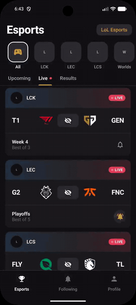
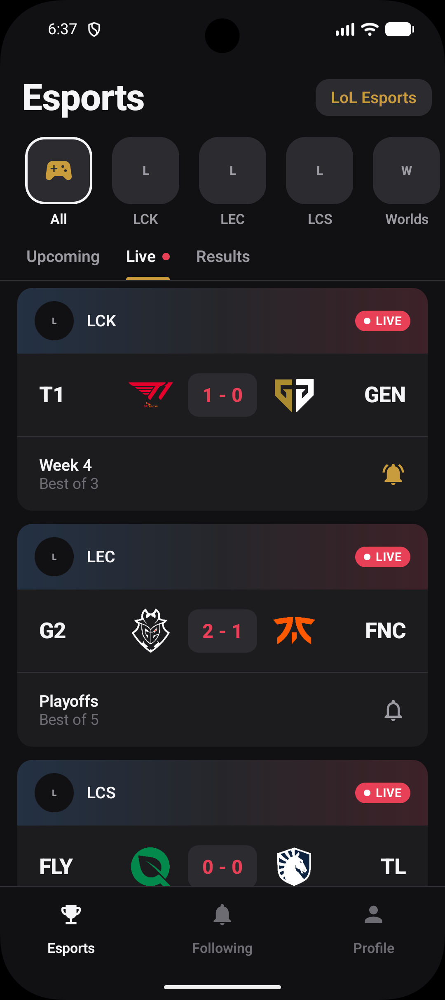
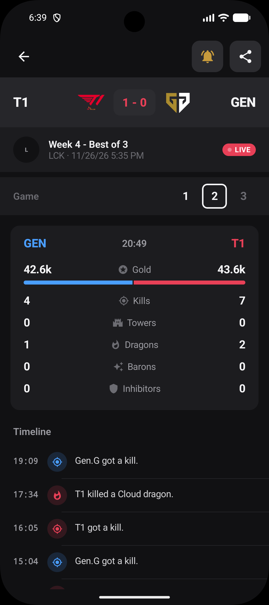
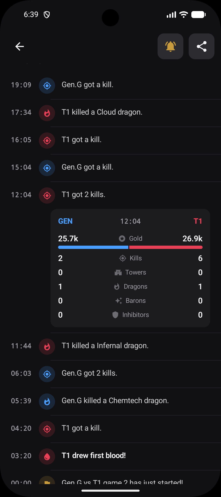
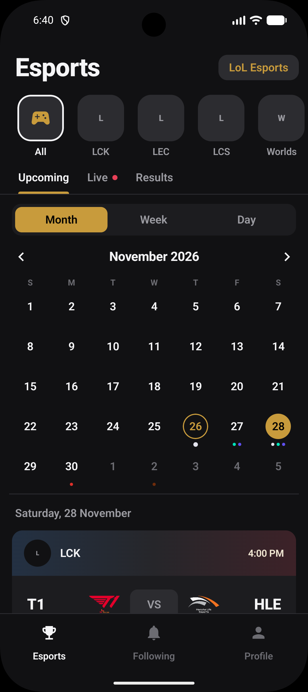
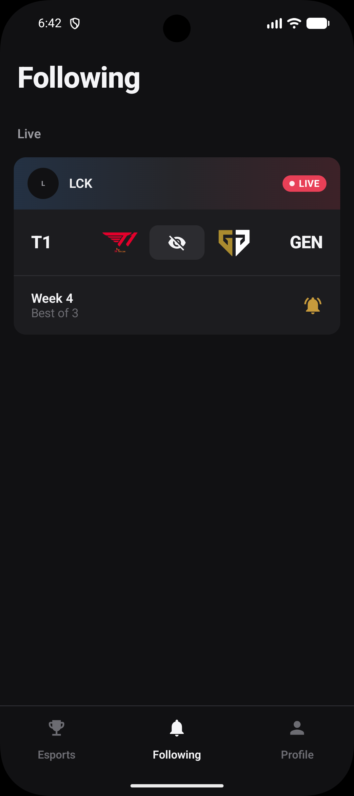
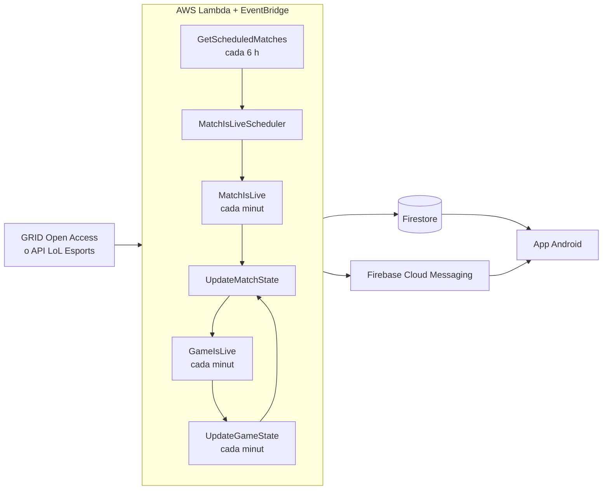

# League of Text

**Follow the biggest *League of Legends* esports leagues live.** An Android app and a serverless AWS backend that track LCK, LEC, LCS, Worlds, MSI and First Stand matches and send a push notification for every in-game event: first blood, dragons, towers, barons, inhibitors and the final result.

<p align="center">
  
</p>

<p align="center"><b>▶ <a href="docs/img/demo.mp4">Watch the full demo (2 min)</a></b></p>

| Live | Match detail | Timeline | Calendar | Following |
|:---:|:---:|:---:|:---:|:---:|
|  |  |  |  |  |

**Stack:** Kotlin · Jetpack Compose · Material 3 · Firebase (Auth, Firestore, Cloud Messaging) · Python 3.12 · AWS Lambda · Amazon EventBridge · AWS SAM · GRID esports API

**Highlights**

- **Event-driven backend:** six Lambdas that schedule each other with EventBridge rules, which only run while a match is live.
- **Real-time app:** Firestore listeners with an offline cache, pull to refresh, a spoiler-free mode and a monthly/weekly/daily calendar.
- **Notifications** grouped per match; the app is available in Catalan, Spanish and English.
- **Tested** with pytest, including the whole match flow with in-memory test doubles.
- Started as my Bachelor's thesis (University of Barcelona, 2023) and rebuilt in 2026: bugs fixed, new architecture and no credentials in the code. See the [list of changes](docs/CANVIS.md).

**Download:** the latest APK is on the [Releases page](https://github.com/SalvaMiraMori/League-of-Text/releases).

<sub>The Upcoming and Live screenshots use the app's built-in demo data (`leagueoftext.mockData`); Results show real Worlds 2026 data.</sub>

---

Aplicació Android per seguir en temps real els partits de les grans lligues de *League of Legends* (LCK, LEC, LCS, Mundial, MSI i First Stand). Mostra els partits programats, en directe i acabats, i envia una notificació push de cada esdeveniment dels partits que segueixes: primera sang, multikills, torres, dracs, barons, inhibidors, pauses i resultat.

La interfície s'inspira en l'app **Riot Mobile**: fons fosc, títols grans, fila de lligues, pestanyes amb subratllat daurat, targetes de partit amb el marcador amagat (ull) i, al detall, el selector de partides 1-5.

> Versió neta del Treball de Fi de Grau (Facultat de Matemàtiques i Informàtica, Universitat de Barcelona, 2022-2023), amb errors corregits, optimitzacions i sense cap credencial al codi. Els canvis respecte de la versió original estan detallats a [`docs/CANVIS.md`](docs/CANVIS.md).

## Estat actual

*Novembre de 2026 · versió 2.2*

**Fet i funcionant**

- **Backend complet:** les sis Lambdes, la plantilla d'AWS SAM, el model de dades unificat a `Matches` i la generació d'esdeveniments (primera sang, multikills, torres, dracs, barons, inhibidors, pauses i resultat). Tot amb tests de pytest, inclòs el flux sencer amb dobles en memòria.
- **App Android:** pantalles Esports (Pròxims · En directe · Resultats, amb filtre per una o diverses lligues i, opcionalment, vista de calendari mensual, setmanal o diària que s'activa al Perfil), detall del partit amb selector de partides i cronologia, Seguint i Perfil. Inici de sessió amb Google, seguiment de partits sense compte, notificacions push agrupades per partit i traducció al català, castellà i anglès.
- **Estirar per refrescar** a Esports, Seguint i al detall del partit: força una lectura al servidor i reinicia els listeners que havien fallat sense esperar el reintent.
- **Pestanya inicial i En directe:** en obrir l'app es mostra la primera pestanya que tingui partits (En directe > Pròxims > Resultats). A En directe només hi ha les targetes dels partits, sense calendari ni dies plegables.
- **Dades de demostració:** amb `leagueoftext.mockData=true` a `android/gradle.properties` (només en compilacions de debug), Pròxims i En directe mostren partits inventats amb hores relatives al moment d'obrir l'app. Les partides en directe avancen soles: el rellotge corre i hi apareixen esdeveniments nous. Resultats continua llegint Firestore. Vegeu `data/MockMatchRepository.kt`.
- **Fila de lligues fixa:** LCK, LEC, LCS, Mundial, MSI i First Stand surten sempre, encara que la pestanya no en tingui partits, i conserven el logotip un cop vist.
- **Migració del model antic** (`backend/scripts/migrate_legacy_collections.py`): reconstrueix el marcador i el guanyador dels partits acabats (el backend antic no desava l'última victòria), descarta els partits obsolets, estalvia quota de Firestore i es pot reprendre. L'opció `--scores-only` corregeix només els marcadors de partits ja migrats.
- **Compilació actualitzada:** Kotlin 2.4.21, AGP 9.5.3 i Gradle 9.6, amb el dimoni de Gradle sobre JDK 25.
- **Dades oficials de GRID:** el backend llegeix els partits de l'API oficial de GRID (Riot Games Open Access) per defecte, amb l'API de LoL Esports com a alternativa (`DATA_SOURCE`). Vegeu [`docs/GRID_API.md`](docs/GRID_API.md).

**Pendent**

- Revocar i regenerar les credencials que encara són a l'historial del repositori antic (vegeu [`docs/CANVIS.md`](docs/CANVIS.md)).
- Fer el desplegament definitiu del backend amb les credencials noves i comprovar-lo durant una jornada de competició real (amb GRID, quan Open Access hi afegeixi lligues; ara només té Worlds 2026).
- Afegir tests de la interfície de l'app (ara només hi ha tests unitaris de lectura de dades i de lligues).

## Arquitectura



| Lambda | Què fa |
|---|---|
| `GetScheduledMatches` | Recorre el calendari, desa els partits de les dues setmanes vinents (`state = scheduled`) i programa una regla *one-shot* una hora abans de cadascun. Si un partit canvia d'hora o d'equips, l'actualitza i el reprograma. |
| `MatchIsLiveScheduler` | Esborra la regla *one-shot* i afegeix el partit a la regla `MatchIsLive`. |
| `MatchIsLive` | Comprova cada minut si el partit ha començat; quan comença, el passa a `live` i invoca `UpdateMatchState`. Si al cap de 6 h no ha començat, deixa de vigilar-lo. |
| `UpdateMatchState` | Compta les victòries, envia el marcador i programa la partida següent, o tanca el partit (`completed`). |
| `GameIsLive` | Espera que hi hagi dades en directe de la partida i la crea. |
| `UpdateGameState` | Llegeix l'estat de la partida (GRID: 4 lectures per minut; LoL Esports: instantànies de 10 s), genera els esdeveniments, els desa i els envia. |

## Estructura del repositori

```
android/                 App Android (Kotlin, Jetpack Compose, Material 3)
  app/src/main/java/com/leagueoftext/app/
    data/                Models, lectura de Firestore, repositoris (partits, subscripcions, sessió, preferències)
    notifications/       Recepció de FCM i notificacions agrupades per partit
    ui/                  Pantalles: Esports, detall del partit, Seguint, Perfil; tema i components
backend/                 Backend en Python per a AWS Lambda
  src/leagueoftext/      Codi compartit (API, lògica de partit i de joc, Firestore, FCM, EventBridge)
    handlers/            Un mòdul per Lambda
  tests/                 Tests amb pytest (lògica i flux complet amb dobles en memòria)
  template.yaml          Plantilla d'AWS SAM (6 Lambdes, capa de dependències i rol IAM)
  scripts/               Migració del model antic, explorador de GRID i importació de partits ja jugats
firebase/                Regles de seguretat i índexs de Firestore
docs/                    Documentació addicional
```

## Model de dades (Firestore)

| Ruta | Contingut |
|---|---|
| `Matches/{matchId}` | `state` (`scheduled` · `live` · `completed`), `startTime`, `bestOf`, `league`, `blockName`, `teams`, `score`, `winnerId` |
| `Matches/{matchId}/Games/{gameId}` | `number`, `state`, `winnerId`, equips, temps de joc i estadístiques en directe (`stats.blue`, `stats.red`) |
| `…/Games/{gameId}/Notifications/{seq}` | `type`, `text`, `playingTime`, `side` i estadístiques en aquell moment |
| `Users/{uid}` | `subscribedMatches` (només el pot llegir i escriure el mateix usuari) |

Si tens dades del model antic (`ScheduledMatches`, `LiveMatches`, `CompletedMatches`), copia-les amb `backend/scripts/migrate_legacy_collections.py` (per defecte fa una simulació; afegeix `--apply` per escriure). Si es talla, es pot tornar a executar i continua on era. L'app també sap llegir les notificacions antigues.

## Credencials

**Cap credencial no és al repositori** (el `.gitignore` les exclou). Cal proporcionar-les així:

| Credencial | On va | Com s'obté |
|---|---|---|
| `google-services.json` | `android/app/` | Consola de Firebase → Configuració del projecte → App Android. Per iniciar sessió amb Google ha d'incloure un client OAuth de tipus web (s'hi afegeix sol en activar el proveïdor Google a Authentication). |
| Clau del compte de servei de Firebase | AWS Secrets Manager (`FirebaseCredentialsSecretArn`) o, en local, `GOOGLE_APPLICATION_CREDENTIALS` | Consola de Firebase → Comptes de servei → Genera una clau privada |
| Clau de l'API de GRID | AWS Secrets Manager (`GridApiKeySecretArn`); en local, `GRID_API_KEY` al `.env` de l'arrel | Compte de Riot Games Open Access a grid.gg |
| Clau de l'API de LoL Esports (només amb `DATA_SOURCE=lolesports`) | Paràmetre `LolEsportsApiKey` (variable `LOLESPORTS_API_KEY`) | Valor de la capçalera `x-api-key` de `esports-api.lolesports.com` |

## Posada en marxa

### App Android

1. Obre la carpeta `android/` amb una versió recent d'Android Studio que admeti AGP 9.5. Gradle descarrega sol el JDK 25 per al dimoni (`gradle/gradle-daemon-jvm.properties`).
2. Copia el teu `google-services.json` a `android/app/`.
3. A Firebase, afegeix l'empremta SHA-1 del teu certificat de debug (`./gradlew signingReport`) i activa Google a Authentication.
4. Executa la configuració `app`.

Sense `google-services.json` l'app compila igualment i mostra una pantalla que explica què falta.

Per veure l'app amb partits a Pròxims i En directe sense backend (captures, vídeos, proves de la interfície), posa `leagueoftext.mockData=true` a `android/gradle.properties`, sincronitza Gradle i executa la configuració de debug.

L'`applicationId` continua sent `com.example.tfg_salva` perquè el `google-services.json` del projecte original segueixi funcionant. Si registres una app nova a Firebase, canvia'l a `android/app/build.gradle.kts`.

### Firestore

```bash
cd firebase
firebase deploy --only firestore:rules,firestore:indexes
```

### Backend

Tests:

```bash
cd backend
python -m venv .venv && source .venv/bin/activate
pip install -r requirements-dev.txt
pytest
```

Desplegament amb AWS SAM:

```bash
cd backend
aws secretsmanager create-secret --name league-of-text/firebase --secret-string file://clau-firebase.json
aws secretsmanager create-secret --name league-of-text/grid --secret-string "<clau de GRID>"
sam build
sam deploy --guided   # demana GridApiKeySecretArn i FirebaseCredentialsSecretArn (DataSource per defecte: grid)
```

La plantilla crea les sis Lambdes (Python 3.12, x86_64), la capa amb `firebase-admin` i `requests`, el rol IAM i l'execució periòdica de `GetScheduledMatches`. Les altres regles d'EventBridge les creen i les desactiven les mateixes Lambdes, de manera que només s'executen mentre hi ha partits actius.

Variables opcionals: `DATA_SOURCE` (`grid` o `lolesports`, per defecte `grid`), `GRID_TITLE_ID` (si no, es consulta), `LEAGUES` (lligues separades per comes), `SCHEDULE_HORIZON_DAYS` (14), `WATCH_BEFORE_MINUTES` (60).

Per explorar l'API de GRID sense desplegar res: `python backend/scripts/grid_explore.py --help`.

Per importar a Firestore partits que ja s'han jugat (p. ex. el Mundial 2026): `python backend/scripts/import_grid_series.py` (simulació) i després amb `--apply`. Vegeu [`docs/GRID_API.md`](docs/GRID_API.md#importar-partits-ja-jugats).

## Tecnologies

- **App:** Kotlin 2.4.21, Jetpack Compose (BOM 2026.09.00, Compose 1.12, Material 3), Navigation Compose, ViewModel + StateFlow, Coil, Firebase Auth (Google amb Credential Manager), Firestore (memòria cau persistent) i Cloud Messaging. Interfície 100% Compose, sense layouts XML. `minSdk` 24, `compileSdk`/`targetSdk` 37. Idiomes: català, castellà i anglès.
- **Compilació:** Gradle 9.6 (dimoni sobre JDK 25), Android Gradle Plugin 9.5.3 amb Kotlin integrat (sense el plugin `kotlin-android`), catàleg de versions a `android/gradle/libs.versions.toml`.
- **Backend:** Python 3.12, `requests`, `firebase-admin`, `boto3`, AWS Lambda, Amazon EventBridge, AWS SAM. Dades: API GraphQL de GRID (Open Access) o API de LoL Esports.

## Limitacions conegudes

- **GRID (Open Access):** les dades en directe arriben amb 5 minuts de retard, el límit és de 6 lectures per minut per sèrie i de moment només hi ha Worlds 2026. No dona la posició dels jugadors ni els enllaços de les retransmissions.
- L'API de LoL Esports (alternativa) no és oficial ni està documentada i pot canviar sense avís.
- Els textos de les notificacions es generen al backend en anglès (la terminologia del joc és en anglès).
- Amb l'API de LoL Esports, si no diu qui ha guanyat una partida al cap d'uns minuts, el backend l'estima a partir de l'últim fotograma (inhibidors, torres, kills i or). GRID sempre indica el guanyador.

## Autor

Salva Mira Mori · Universitat de Barcelona
