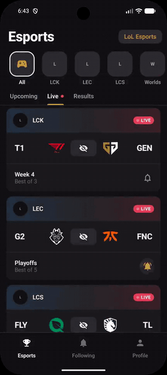

# League of Text 2.2

**Tag:** `v2.2` · **Title:** League of Text 2.2: official GRID data, calendar and demo mode

League of Text started as my Bachelor's thesis (University of Barcelona, 2023): an Android app that follows the biggest *League of Legends* esports leagues and sends a push notification for every in-game event. This release is the result of rebuilding it in 2026: new architecture, the original bugs fixed, official match data and no credentials in the code.

## Highlights

- **Official data from GRID** (Riot Games Open Access) for schedules and live game state, with the unofficial LoL Esports API kept as a fallback (`DATA_SOURCE`).
- **New Android app in Jetpack Compose**, styled after Riot Mobile: Upcoming / Live / Results tabs, match detail with a game selector, live stats and an event timeline, a Following tab and a Profile screen.
- **Calendar view** (month, week or day) and filtering by one or several leagues.
- **Demo mode** with built-in matches that play out in real time, so the app can be shown without a running backend.
- **Security:** every credential removed from the code and moved to AWS Secrets Manager or local config files ignored by git.

## App

- Real-time lists from Firestore, with a single shared listener per list and a 50 MB offline cache.
- Pull to refresh on Esports, Following and match detail.
- Follow matches without an account, or sign in with Google to keep them across devices.
- Push notifications grouped per match; tapping one opens the match.
- Spoiler-free mode: scores stay hidden until you tap the eye.
- Opens on the first tab that has matches (Live > Upcoming > Results).
- Available in Catalan, Spanish and English.
- Kotlin 2.4.21, Android Gradle Plugin 9.5.3, Compose 1.12, Material 3, minSdk 24, targetSdk 37.

## Backend

- Six AWS Lambdas (Python 3.12) deployed with AWS SAM. They chain each other through EventBridge rules that are created and disabled on demand, so they only run while a match is live.
- One `Matches` collection with a `state` field, instead of copying documents between three collections.
- Events generated for first blood, kills and multikills, towers, dragons and souls, Elder Dragon, Baron Nashor, inhibitors, pauses and game results.
- Late start: if a game is already running when tracking begins, the backend catches up instead of flooding users with old events.
- Scripts to import already-played series from GRID (e.g. Worlds 2026) and to migrate data from the old model.
- pytest suite, including the full match flow with in-memory test doubles.

## Fixed since the thesis version

Some of the most important ones (full list in [docs/CANVIS.md](https://github.com/SalvaMiraMori/League-of-Text/blob/main/docs/CANVIS.md)):

- Firestore listeners were added on every change and never removed, so reads grew without limit.
- Two events in the same second (e.g. a tower and a kill) overwrote each other.
- Stats were parsed from notification text at fixed positions and broke with long team names.
- Infinite retry loops and a missing `import time` could crash or hang the Lambdas.
- Postponed matches stayed scheduled forever, and TBD teams were never updated.
- Pause notifications were repeated on every paused frame.

## Assets

- `league-of-text-2.2-demo.apk`: debug build with demo data. Upcoming and Live show sample matches that play out in real time; Results show real Worlds 2026 data. **Recommended for trying the app.**
- `league-of-text-2.2.apk`: release build that reads live data only. Outside competition periods the Upcoming and Live tabs may be empty.

To install, allow installing apps from unknown sources on your Android device (Android 7.0 or later).

## Known limitations

- GRID Open Access currently only includes Worlds 2026. Live data arrives with a 5-minute delay and is limited to 6 requests per minute per series.
- Notification texts are generated in English (the game's terminology is in English).
- The app has unit tests for data parsing and leagues, but no UI tests yet.
